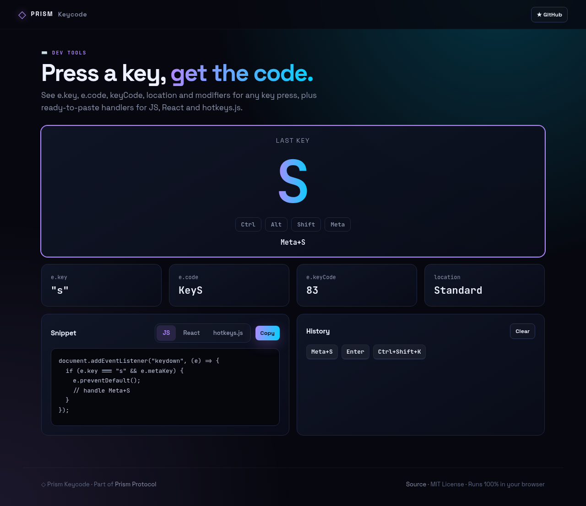
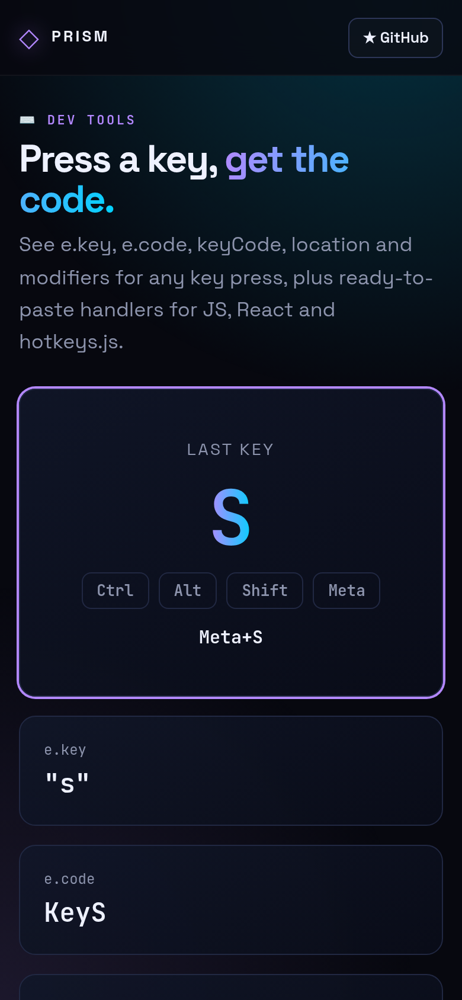

<!-- ═════════════ HEADER ═════════════ -->
<p align="center">
  
</p>

<p align="center">
  
</p>

<p align="center">
  <a href="https://github.com/krishyaa06/prism-keycode/actions/workflows/ci.yml"></a>
  <a href="https://krishyaa06.github.io/prism-keycode/"></a>
  
  
  <a href="LICENSE"></a>
</p>

<p align="center">
  
</p>


## ⚡ Overview

**Prism Keycode** shows everything the browser reports for a key press: `e.key`, `e.code`, the legacy `keyCode`, key location (left/right/numpad) and live modifier state. Each press becomes a shortcut combo and a ready-to-paste handler for vanilla JS, React or hotkeys.js, and recent presses are kept in a clickable history.

## ✨ Features

- **Big live readout** of the last key with modifier lights
- **e.key / e.code / keyCode / location** at a glance
- **Shortcut combo** formatting (Mac symbols on macOS)
- **Snippets** for vanilla JS, React `useEffect` and hotkeys.js
- **History** of recent combos — click one to regenerate its snippet
- Prevents default browser actions so you can test combos like Ctrl+S

## 📸 Screenshots

<table>
  <tr>
    <td width="68%"></td>
    <td width="32%"></td>
  </tr>
</table>

## 🚀 Quick Start

**Use it online:** [https://krishyaa06.github.io/prism-keycode/](https://krishyaa06.github.io/prism-keycode/)

**Run locally:**

```bash
git clone https://github.com/krishyaa06/prism-keycode.git
cd prism-keycode
# open index.html in your browser, or serve it:
npx serve .
```

## 🛠️ Usage

Open the page and press any key or combination. Pick a snippet flavour and hit **Copy**. Click a key in **History** to bring back its snippet.

## 📁 Project Structure

```
prism-keycode/
├── assets/
│   ├── logo.png
│   └── logo.svg
├── css/
│   ├── app.css
│   └── prism.css
├── js/
│   ├── app.js   # keyboard listeners and UI
│   ├── core.js   # event description + snippet generation — tested in Node
│   └── prism.js
├── test/
│   └── core.test.js
├── .gitignore
├── LICENSE
├── README.md
├── index.html
└── package.json
```

## 🧪 Tests

```bash
npm test
```

Tests use the built-in `node:test` runner, so there is nothing to install. CI runs them on Node 20 and 22.

## 🤝 Contributing

1. Fork the repo and create a branch: `git checkout -b feature/my-idea`
2. Make your change and add a test in `test/`
3. Run `npm test` and open a Pull Request

## 🔷 Part of Prism Protocol

Prism Keycode is one of the open-source tools built by [Prism Protocol](https://dc.gg/prismprotocol), a tech community where young builders learn, ship and compete together.

## 👤 Author

<table>
  <tr>
    <td align="center">
      <a href="https://github.com/krishyaa06"><br><b>Soumya Bhandare</b></a><br>
      <sub>Founder @ Prism Protocol</sub>
    </td>
    <td>
      <a href="https://dc.gg/prismprotocol"></a><br>
      <a href="https://instagram.com/prism_protocol_"></a><br>
      <a href="https://x.com/krishyaa06"></a>
    </td>
  </tr>
</table>

## 📄 License

Released under the [MIT License](LICENSE).

<p align="center">
  <b>If you like this project, consider giving it a ⭐</b><br>
  <sub>"Build. Create. Compete." · Made with ⚡ by Prism Protocol</sub>
</p>


